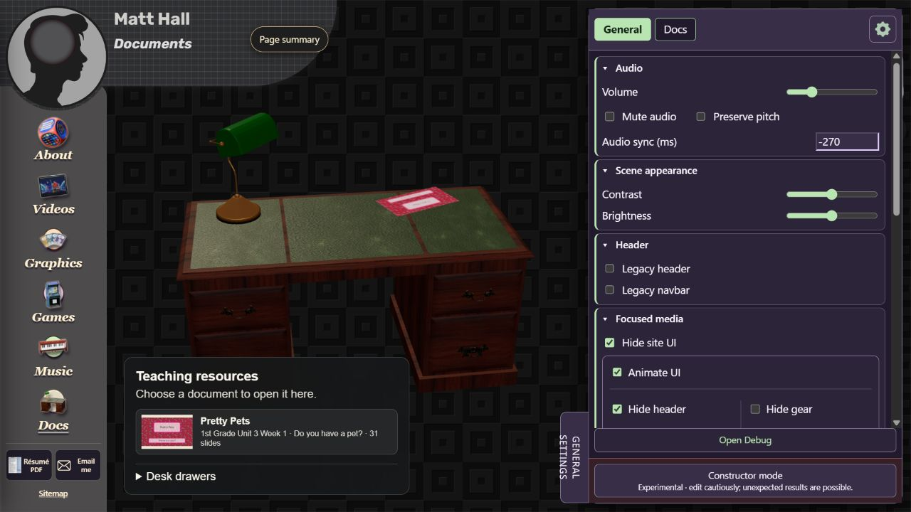

# Chapter 2 - Settings Constructor and shared interface

## The three control layers

Settings adjusts existing preferences. Constructor exposes authoring controls that a page or face registers. Debug reports diagnostic state. They share a panel host but have different responsibilities; the `debug` directory contains normal runtime settings code as well as diagnostic tooling.

Start at `debug/panel-shell.js` for drawer behavior, tab registration and common markup. `panel-shell.css` styles the shell. Page owners call `registerContext` for ordinary settings and `registerConstructorContext` for authoring contexts. A missing Constructor context is not an instruction to switch to another face.

## Change an existing shared default

1. Find the control's `data-setting` path in the markup or owner. For example, the transform-reset control uses `interaction.animateResets`.
2. Find that path in `_7-shared-scripts/core/settings-schema.js`. Review its default, parser/range, storage key and legacy compatibility.
3. Change the default only if this is a source-default change. Existing saved preferences should remain valid and may continue to override it.
4. Find the feature subscriber or getter that consumes the path. A visible control without a consumer changes a number, not behavior.
5. Check the field-specific reset, reload, saved zero/false values and cross-page updates. Never use truthiness to discard a valid zero or false value.

Use `core/settings.js` for shared state and subscriptions; `core/settings-controls.js` for common binding. Private face content can have a different format and transfer owner.

## Add a setting without duplicating boilerplate

1. Define one stable path and bounded type in the schema.
2. Add its control to the owning context, using the existing `data-setting` binding or the owner's established adapter.
3. Consume the new value in the feature through its existing settings subscription. Unsubscribe through the page scope/owner disposal.
4. Include the field in the correct import/export scope. Mark embedded shared-preference groups with `data-shared-settings` when the context also has private transfer logic.
5. Supply a default and a migration strategy before renaming or changing stored meaning.

Do not create a second storage key just to avoid following an existing compatibility path. For a label-only rename, retain the stored path.

## Sections and introductory text

Shared section behavior lives in `panel-assembly/CollapsibleSections.mjs`. It preserves existing control nodes and listeners while adding fold behavior. Use native details/summary or the shared helper; do not rebuild the form merely to collapse it.

An introductory heading can carry `data-section-static` to remain a static title rather than become an outer fold. Docs Constructor uses this for Document library: its explanation stays above the independent Document, Source and cover, and Paper format and placement groups.

Meaningful nested groups should remain nested. A parent that has its own settings or represents a real feature boundary is different from a duplicate title around the entire tab. Left-click folds one section; right-click toggles the owning context's sections. Late-inserted groups need an explicit shared refresh rather than a global mutation observer.

Maintainer transfer behavior is documented in `_8-tools-and-notes/settings-menu-gestures.md`. Do not advertise its hidden middle-click gestures in visitor-facing instructions or hints. Preserve the private owner's format and transfer dismissal behavior.

## Motion controls and accessibility

`core/motion-preference.js` combines site and operating-system Reduced motion. Use the shared preference for new decorative motion rather than checking only the OS media query.

The saved Animate UI preference is independent: enabling it must not turn off Reduced motion. While Reduced motion applies, its effective UI state can be unchecked/disabled without destroying the saved preference. Points of interest has its own navigation-motion control; media tempo is a separate setting.

Transform resets use `shared-glb-mouse-controls.js`, `core/transform-easing.js` and the reset controls under `debug`. Keep the page's canonical pose separate from its current user pan/rotation. A reset should restore that pose, with About's upright-face behavior retained.

## Header navbar and utilities

The shared fragment is `_7-shared-scripts/header.html`; behavior is `core/header.js`, `template.css` and `colors.css`. Some pages also have local styles. Legacy header and legacy navbar are independent saved choices.

To change a shared navigation destination, edit the source fragment. Then inspect `tools/prepare-site-html.mjs` and `data/runtime-dependencies.json`. The generator writes marked regions in multiple HTML pages and the worker config. Reserve/co-ordinate all generated destinations before write mode; review the resulting diff and run check mode. Do not fix only one generated page.

Focused media layering/movement belongs to `core/presentation-ui.js`; controls are in `debug/settings-focused-media.js`. Both Settings and Debug consume viewport space measured by `core/panel-viewport.js`. Preserve access to Back and the requested gear while moving decorative UI away.

## Page summary and selected work

`core/page-summary.js` contains shared descriptions and receives actual actions through `registerPageSummaryPoints`. To add a point, register the owner callback, label it accurately and preserve readiness/input guards. Use `getPoiMotion` for navigation timing rather than changing media playback speed.

Selected work spans `core/selected-work.js`, header markup and Start's `start/project-overlays.js`. The featured set currently includes coursebooks, NeoTube, Global Conquest and Plunky. Match visible labels/art to the real launcher; do not invent factual project outcomes.

## Verify a shared interface change

Check every affected route, not only the page where the issue appeared. Try open/closed Settings and Debug, normal and legacy header modes, keyboard focus, reduced motion, narrow width and a focused media player. For sections, verify fold-one, toggle-all and saved expansion without losing form values.

Browser verification on 29 October 2026 confirmed the General section labels, the Constructor switch and context tabs on Docs, About and Music. This check did not change saved preference values or certify every control's effect. Remaining: full interaction acceptance and the exhaustive per-owner field index. Broader easing/custom-curve work, controller extraction and file migration remain separate phases.
