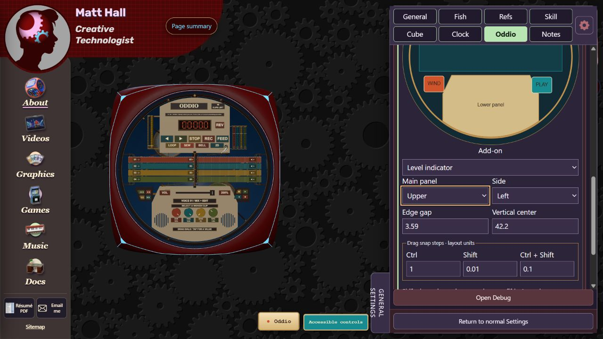

# Chapter 3 - About cube and faces

## Find the right owner

`_1-about/about.html` loads `about.js`; that host owns the renderer, camera, model, cube input and lifecycle. `faces/index.js` registers Fish, Refs, Skills, Clock, Oddio and Notes. The face modules borrow the cube context and dispose their own added resources; the host owns shared geometry/materials.

Use Page summary to reach a face. Open the gear for its Settings context, or Constructor for authoring controls implemented by that owner. Visible names differ from compatible internal IDs: Fish is `about`, Oddio is `odd`, and Cube uses settings context `faces`. Retain these IDs when changing labels.

Shared construction belongs to `faces/backing-controls.js`, `face-layout.js`, `face-travel.js` and related host modules. Geometry remains authored in the face's own coordinate space while the host maps it to the physical cube. Read `_8-tools-and-notes/about-face-coordination.md` before changing shared layout or borrowed nodes.

## Fish modes artwork and motion

Start with `faces/about/face.js`, `fish-face.js`, `picture-library.mjs` and the local README/assets. Fish and the picture-gallery/ring mode are separate presentations; inspect the mode selector before editing the wrong implementation.

### Adjust an existing feature

1. Reach Fish and inspect its ordinary Settings and Constructor controls.
2. Change the specific mode/motion/appearance control and record its old value.
3. Check opening and closing, stowed/deployed poses and return to Fish after selecting another mode.
4. For source changes, trace the control path into its settings definition and the relevant Fish mechanism function. Change both validation and consumer if its range/meaning changes.
5. Verify site contrast and Reduced motion, then save/export configuration through its actual owner.

### Replace picture imagery

Use the local artwork library workflow in the face README. Keep authored files and the generated catalog consistent; `tools/about-artwork-catalog.mjs` participates in packaging. Browser-imported gallery images and project artwork are not the same storage. Export settings does not necessarily include those binary images. Confirm ordering, captions, missing images and reload before replacing a published gallery.

## Refs cabinet doors and layouts

The owner is `faces/refs/face.js` with `cabinet.js`, `doors.js`, `controls.js`, `editor.js` and supporting modules. Its README describes the implemented cabinet/editor model.

For a cabinet construction edit, start with the housing/door owner rather than the cube host. For displayed art or a layout, start with the editor and the corresponding source/persistence module. Preserve private browser layouts before refreshing an edited tab.

1. Identify whether the requested change affects geometry, artwork, selection or a saved layout.
2. Locate the visible control/label in the Refs directory and follow its handler to the data owner.
3. Make a bounded change; keep content and geometry changes separate where possible.
4. Check door opening/closing, selection and focus, aspect changes and any backing clearances.
5. Perform a layout/content export/reload/import round trip through the Refs owner. Do not assume the shared settings archive is a complete layout/art backup.

## Skills panels and beanbags

`faces/skills/face.js` integrates the feature. The neighboring BeanBag modules separate container, visuals, supply, throw behavior and sounds. Shared panel construction is under `_7-shared-scripts/panel-assembly/`.

To change a throw, follow `BeanBagThrower.mjs`; appearance starts with `BeanBagVisuals.mjs`; available objects and supply start with `BeanBagSupply.mjs` and `BeanBagContainer.mjs`. A label/panel change can belong to the shared assembly rather than the throwing mechanism.

Verify pickup/throw/return behavior, active versus suspended state, sound permission, reduced motion and the surrounding cube faces. Do not dispose a host-owned cube mesh from the Skills owner. A larger physical layout change requires shared clearance review.

## Clock hands mechanisms and controls

Use `faces/clock/face.js` and `controls.js` to trace current controls. Hand, winding, magnetic drive, spiral and appearance behavior have separate modules in that directory. JSON mechanism data is an input contract, not merely decoration.

1. Find the control or displayed mechanism you want to change.
2. Trace its input through controls into the mechanism owner; avoid editing the shared host for a hand-only change.
3. Preserve node names, parent references and any shared interior target used by the cube's magnetic drive.
4. Check normal winding, pause/suspension, Reduced motion and live contrast.
5. Review deployed and retracted geometry, because correct time behavior does not prove mechanical clearance.

## Oddio existing panel layout

The physical side panels are already configurable. Constructor -> Oddio -> Side-panel placement supplies a diagram and fields for allowed upper/lower host, left/right side, edge gap and vertical center. The solver constrains each complete panel to its permitted area; not every panel can attach everywhere.

`addon-layout.mjs` defines panel dimensions, host constraints and defaults. `addon-layout-editor.js` provides the authoring diagram/fields. These move whole add-ons; they do not provide arbitrary independent placement of every button on the main covers.

### Rearrange the four-button panels

1. Choose the transport or tape-movement add-on in the Constructor diagram.
2. Use the four-button panel editor to swap slots or select a supported function. Existing configuration also supports icon/color/image choices and horizontal/vertical flips.
3. Inspect the physical face at front and oblique angles. Confirm the printed icon, hit target and assigned function agree.
4. Check the saved state and transfer through the Oddio owner. Reset a specific layout rather than clearing the whole site's preferences.

The action inventory is `pod-config.mjs`; authoring is `pod-editor.js`; physical control construction/input includes `shuttle-controls.js` and `face-input.js`. The current two panels each have four slots. Adding a fifth physical button is a code/geometry change, not an assignment-only change.

## Oddio connecting a 2D action to 3D

`face-runtime.js` creates the deck and dispatches physical actions through `perform(action)`. `deck.mjs` owns the accessible 2D interface and exposes the shared engine. `cloth-rig.js` owns the physical tape/reels. The physical and accessible interfaces already share transport/audio state.

1. Find the existing 2D control's `data-action` or control handler in `deck.mjs`.
2. Confirm it is a one-shot action, a held action, a toggle, or a numeric/drag value. These need different physical input handling.
3. For a supported panel assignment, use its existing action ID. For a new assignable action, extend the allowed configuration/icon inventory, then add the corresponding physical dispatcher mapping.
4. Route it to the existing deck/engine or rig owner. Some current mappings call the corresponding 2D button through `.click()`; a future explicit action API can make the bridge less dependent on markup. Do not create another engine or duplicate playhead state.
5. Add enabled/disabled and pressed-state feedback. Preserve recording/loading locks, selection requirements and sound permission.
6. Check 2D and 3D after the action, plus undo/redo, pause, reverse, seek, held winding, suspension and Reduced motion where relevant.

A file/microphone action also needs real user-gesture/permission acceptance; a synthetic event or unit-level call is not proof of device access. Panel rearrangement must not put buttons in the arms/tape path.

## Notes drawing tools layers and saving

`faces/notes/face.js` is the adapter; `_1-about/notes/notes-face.js` coordinates the workspace. Editor, model, layer tree, history, gears and export/library modules live under `notes/`. This split is intentional.

For a tool change, trace its toolbar selection into the drawing editor and input owner. For a layer change, start with `drawing-layers.js` and follow its document actions; preserve grouping, visibility, locking and selection. For undo/redo, locate the document/history boundary rather than implementing a second history stack in the UI.

1. Create or duplicate a small disposable drawing in a review context.
2. Exercise the changed tool, selection and layer behavior.
3. Undo/redo it, including cancellations and gestures that should count as one edit.
4. Save/export through Notes' own controls. Check the difference between editable drawing data, collection/library data and an image export.
5. Reopen the editable data and inspect layers/anchors as well as the visible result. A PNG cannot prove editable content survived.

The Notes owner is actively changing export/tool behavior. Follow its current handoffs and code; do not reload a tab holding unexported work just to apply a control update.

## Fallback and shared acceptance

The text fallback is independent HTML/CSS plus `fallback-carousel.js`. Previous/Next and dot buttons must still work if the 3D module fails. Keep current-dot indication and keyboard access when changing the fallback's text or slide count.

Remaining: rendered verification of current face control paths, content round trips, normal/reduced motion, contrast, suspend/resume and narrow layouts. Shared physical changes need sampled clearance checks and user visual review. This chapter does not certify device audio/microphone access or fabrication safety.
