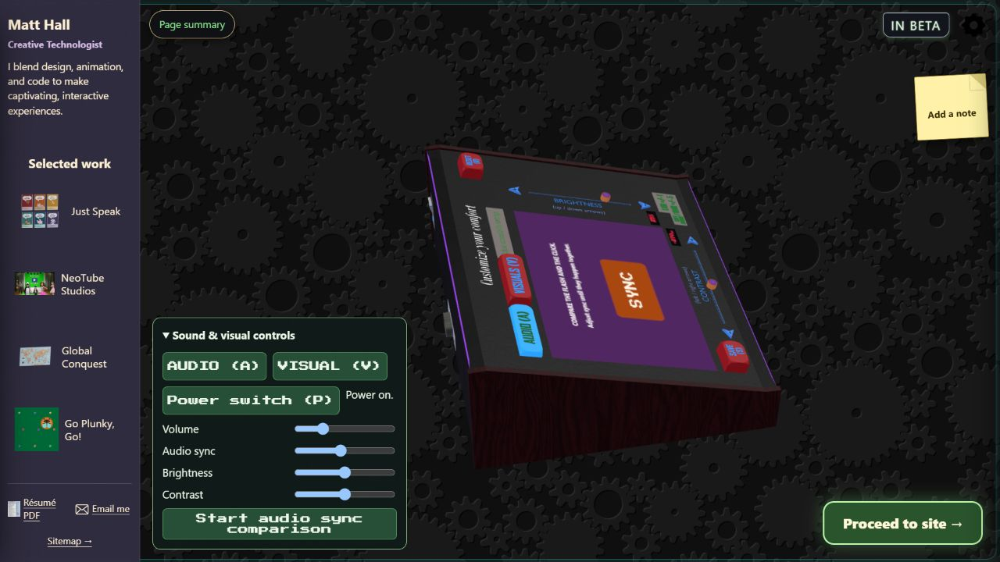
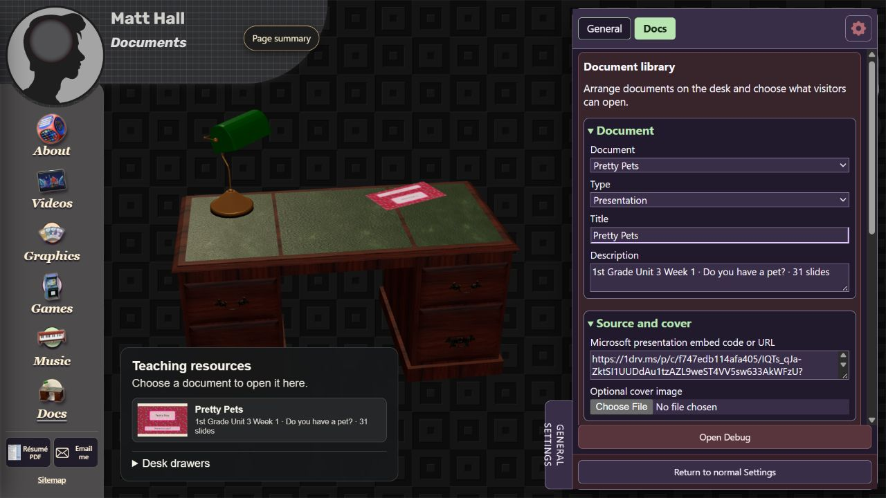

# Chapter 4 - Page content and document library

## Start welcome and selected work

Start is root `index.html` with `_0-start/start-page.js` and helpers under `start/`. Native markup, model/controller behavior and selected-work overlays are separate pieces.

To update a visible welcome paragraph, search its exact phrase in `index.html` and the Start/shared modules. Edit the active text owner; retain IDs used by switches and accessibility links. Check both the 3D controller view and text introduction because they can show different markup.

To replace a featured project, trace the project ID across `_7-shared-scripts/core/selected-work.js`, shared header markup and `_0-start/start/project-overlays.js`. Change title, preview artwork and launcher consistently. The project host can embed content from another page without navigating away; preserve its Back/focus restoration and suspension of the underlying scene/media. Changing the label alone does not change the launched work.

## Graphics coursebook content

`_3-graphics/graphics.js` mounts `shelf/graphics-preview.mjs`. Keep grade artwork, closed proxies, traveling pages and reader detail tiers consistent. `shelf/README.md` is the feature's implementation reference.

1. Select the intended grade and find its asset directory under `shelf/assets/`.
2. Identify the current image naming convention and any atlas/manifest or exporter. Preserve the expected order of front/back covers, inside covers and numbered pages.
3. Replace the editable original or regenerate the needed web tier; do not substitute one enormous source image into every proxy/travel slot.
4. Open the book through Page summary and the physical shelf. Check covers, every affected spread, neighboring pages, grid/spread switching and put-away/return.
5. Review page surface settings before changing images to fix a material problem. Relief, grain and ink settings can make correct art look wrong.

Navigation/page turning belongs to book modules and `page-controls.mjs`. A grade-label change should not rename persistent book IDs or source mesh names without a migration.

## Graphics boxes and freeform tabletops

The physical boxes are shelf assets. Their inspection/control owner includes `game-view-controls.mjs`; the freeform table is `tabletop.html`, `tabletop.mjs` and supporting model/input/session modules. These boards do not execute the arcade's game rules.

For a board-art change, inspect the board generator and source design file before replacing the generated JPG. Global Conquest's card atlases, manifests, full-detail faces and masters are related outputs; regenerate them together through the current card workflow. For a character change, prefer the existing Games/Tabletop character settings and approved default artwork rather than painting over the entire board image.

Check card identity/order, draw/cut/shuffle, player hand ownership and reset behavior after content changes. For dice/stands, confirm the displayed result and pose agree. Preserve original authoring packages even when only the web table uses the exported images.

## Arcade game content

The cabinet is `_4-games/games.js`; embedded exports live in root `games/`. Use the cabinet owner for menu labels, reel selection, input bridging and presentation. Use the individual game's original editor/export process for its rules and internal art.

Before modifying an export, find its entry HTML, runtime files, data and audio folders. Some projects are generated bundles: hand-editing one generated data file can be overwritten by the next export. Document a necessary web integration patch separately from authoring changes. Verify direct game entry and cabinet embedding, including loading cover, sound permission and return focus.

## Docs collection editing

The desk/library page is `_6-docs/docs.html` -> `docs-3d.js`. `documents.json` describes project content. `library/editor.js` creates the Constructor UI; `library/schema.js` validates allowed types, paths and dimensions.

### Add or update a PDF or image

1. Open Docs, the gear, then Constructor's Docs context.
2. Select an existing document or use the current add/new action. Choose PDF or Image.
3. Supply the file through Upload PDF, image, or document. The local review server handles bounded file uploads and creates a project-local source; it is not a production upload service.
4. Enter the title and concise description. Add an optional cover if needed.
5. Choose a paper preset, then adjust width/height, scale, Desk X/Z and rotation. Dimensions are metres; an A4 sheet is about 0.210 by 0.297 m.
6. Inspect placement on the desk and open the actual document. A correct cover alone does not prove a full PDF was retained.
7. Save to project on the local review site when ready. Reload a separate review tab and confirm content and source links survive. Export the manifest as a supplementary backup.

Browser edits are a local draft before Save to project. The project manifest and uploaded document binaries must both be included in a usable collection backup. Review `_6-docs/README.md` for current upload availability and limits.

The current Document type also accepts original DOCX/PPTX/XLSX, ODT/ODP/ODS, RTF, TXT and MD files through the bounded local upload flow (20 MB limit). Most use an original-file link; TXT and MD additionally show plain text. PDF preparation can generate a cover and up to 120 page JPEGs when Poppler is available, while keeping the complete original. This is source-documented behavior; this guide's browser pass inspected the controls without uploading new content.

Save document previews a browser draft; Save to project writes the collection to the local website. Export metadata JSON and Import metadata JSON transfer the manifest, not every original binary.

### Add or update a PowerPoint presentation

1. Host the full presentation on an allowed Microsoft service and obtain its public embed/link through the web presentation interface.
2. Choose Presentation in Docs Constructor and paste the embed code or supported HTTPS URL into Microsoft presentation embed code or URL.
3. Set a widescreen preset when appropriate, title/description and optional cover.
4. Open it on the site and advance beyond the cover. Test its permissions signed out; an owner-only OneDrive session can hide a public access problem.
5. Save the reviewed collection to project. Keep the external full-deck URL rather than replacing it with a static screenshot.

Uploading PPTX preserves its original file; it does not supply the hosted inline slide player and animations. Use the permitted Microsoft embed/link for that experience. Microsoft hosting permissions and document availability are separate from the local manifest.

## Desk appearance and drawers

The web model is `_6-docs/assets/desk.glb`; export recipe and material limits are in `tools/export-docs-desk.py` and `assets/README-desk.md`. Editable original/extracted Blender assets are under `assets/.blend/...` and `source-files/docs-desk-and-cabinet/`.

If replacing the desk, preserve tabletop scale/position or deliberately update paper placement. Keep the four `Drawer_TL`, `Drawer_TR`, `Drawer_BL` and `Drawer_BR` nodes and their hardware parenting. `desk-drawers.js` uses exported parent-local `docsDrawerOffset` metadata. Renaming or flattening these nodes breaks the expected interaction unless the code is updated together.

Verify document picking and drawer picking against the nearest visible surface, plus sticky-note placement and keyboard controls. Do not let a document click open a drawer through the desktop.

Browser inspection on 29 October 2026 confirmed the Docs Constructor route, all three section groups, document-type menu, placement fields and Save document / Save to project / Export metadata JSON controls. Remaining: upload/save/reopen/content round trips, signed-out presentation access and the other page recipes. Shared layout migrations, new game rules and a production content-upload backend are separate scopes.
