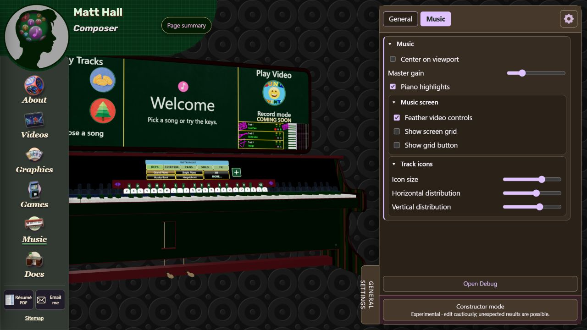

# Chapter 5 - Video music and instruments

## Identify the media owner

A player may combine a silent visual file with a separate audio file. Music additionally uses MIDI to drive falling notes and keys. Diagnose the owner that produces the sound before changing gain or timing: a synth setting cannot fix the volume of a recorded soundtrack.

Main owners: Videos uses `_2-videos/videos.js` and `videos-video-adapter.js`; Games uses `_4-games/games.js`; Music uses `_5-music/music-piano-controls.v2.js`; Graphics easel uses `shelf/easel-video.mjs`; Start overlays reuse shared media through the project launcher. Shared controller/drawing/input/transport helpers are under `_7-shared-scripts/media/` with compatibility wrappers and `video-player-controls.js`.

## Replace a video or soundtrack

1. Find its catalog/configuration entry and all candidate URLs. Check `media-catalog.js`, page configuration and the actual adapter dispatch path.
2. Identify whether the displayed clip is a low-quality preview, HQ playback source, separate soundtrack, intro/calibration file or external link.
3. Prepare the correct video/audio formats and preserve the expected aspect ratio and duration relationship. Update paired sources together where required.
4. Resolve the path through `core/assets.js` and the asset policy. On production, the same family may resolve to the asset host rather than local disk.
5. Check metadata readiness, first play, pause, seek, replay, rate/pitch, mute/volume and Back/Escape. Include failed-load and denied-audio paths.
6. Confirm synchronization at the beginning, middle and end. A successful HTTP response does not prove decode, audible output or good sync.

Do not use an intro loading timeout as permission to advance its animation. Preserve its explicit terminal conditions and cleanup.

## Change player layout or shortcuts

Shared visual controls are in `media/controls-view.js`; input hit testing is in `controls-input.js`; page action owners must implement the dispatched operation. Change visual bounds and hit bounds together. Keep the seek target forgiving without letting a seek press fall through to play/pause.

The common help guide is built through `core/page-shortcuts.js`. List only supported actions for that player: Videos can have caption/tablet controls, while Music's recorded-track surface does not have every standalone-video view action. Button speed cycling wraps; keyboard stepping stops at the supported endpoints. Shift+Comma/Period must recognize physical codes and shifted less-than/greater-than keys.

After changing a shared layout, review Videos, Games, Music and Start, plus hidden/disabled controls. Mouse pan/rotate must suppress timeline previews and prevent accidental transport activation. A keyboard shortcut must leave typing fields and open dialogs alone.

## Music instrument selection and sound

The active 3D controller is `music-piano-controls.v2.js`; the instrument catalog and loaders/backends are under `instruments/`. The contextual More picker lists instruments by group. The 2D piano/recorder remains a separate route.

To change a default sound slot, find its catalog/configuration record, stable ID, group, patch/backend and source candidates. Update the displayed label to match. Keep fallback/loading/error behavior intact. A sound that fails to load should not claim readiness merely because the UI selection changed.

To add an instrument, first confirm its source format/license, backend support and key range. Add it through the existing catalog/loader contract, not an ad hoc AudioContext per key. Test low/middle/high notes, repeated notes, overlaps, sustain, release and switching instruments while notes are held. Sample instruments and oscillator/SF2 backends can have different ownership/polyphony limits.

## Update a recorded Music track

Track records link audio candidates, MIDI and optional video. Relevant helpers include `music-track-timing.mjs`, `midi-seek-state.mjs`, `music-recorded-volume.mjs`, `music-screen-layout.mjs` and `music-track-icon-layout.mjs`.

1. Read `_8-tools-and-notes/music-midi-workflow.md` and the track's preparation recipe in `source-files/music-midi/`.
2. Preserve the source tempo map and per-song calibration. A fixed stretch intended for one song must not silently affect another.
3. Update audio/MIDI/video records together. Keep the stable track ID unless migrating saved state.
4. Start from a real gesture after sound permission. Compare sound landmarks with keys/notes at multiple points.
5. Seek during playback and while paused. Sustain and note state must be reconstructed at the seek target; seeking must not reset the chosen screen/instrument mode unexpectedly.
6. Change rate and confirm recorded audio, video and MIDI visual clock follow the same effective timeline. Test pause/resume and the ending.

For volume faults, trace the recorded audio element or gain owner before changing live-instrument master gain. Preserve the existing consent/mute/sync route rather than assigning media volume in an unrelated loop.

## Audio consent and saved preferences

Shared consent, volume and sync are owned by `audio-consent.js`, `audio-settings.js` and `global-sync.js`. A query parameter or cached readiness is not permission to play sound. Apply effective mute/denial before starting an asynchronous load/play operation, and invalidate stale permission results if the user changes state mid-load.

Test allowed, denied, muted and zero-volume cases separately. Restore test-modified preferences afterward. A browser's successful play promise does not prove speaker output, and a muted successful run does not prove audible synchronization.

## Captions and soundfont packages

Videos caption drafts live in `_2-videos/captions/`. Preserve cue order and timing, proofread against actual playback and test the caption toggle. Do not assume automatic transcription is final publication-ready copy.

Soundfont packages can involve external inputs, IndexedDB storage and backend preparation. Keep package identifiers, hashes/licenses and manifests together. Do not replace a failed real bank with a synthetic fixture and declare the original workflow accepted. Disk persistence and live decoded memory are different budgets.

Remaining: real listening/device and denied/revoked paths, full seek/rate/pedal acceptance and current backend/storage limits. New media, model variants and large controller extraction are separate phases.
